<div align="center">

# WebGIS Tutupan Lahan Kabupaten Bantul

**Analisis indeks spektral (NDVI, NDBI, NDWI, NDCI) dan klasifikasi tutupan lahan dari citra Sentinel-2 Level-2A, disajikan dalam aplikasi WebGIS interaktif berbasis R Shiny dan Leaflet.**


### [🌐 Buka Aplikasi Web](https://nisrinsafina.shinyapps.io/bantul-landcover/) · [📖 Langkah Pengerjaan](docs/LANGKAH_PENGERJAAN.md) · [📝 Riwayat Perubahan](CHANGELOG.md)

</div>

---

## About Project

Repositori ini berisi tugas **Evaluasi Tengah Semester (ETS) Pemrograman Spasial (CM234529) Kelas A**, Institut Teknologi Sepuluh Nopember (ITS), dengan wilayah studi **Kabupaten Bantul, Daerah Istimewa Yogyakarta**.

Citra Sentinel-2 Level-2A dipotong sesuai batas kabupaten, lalu dihitung empat indeks spektral. Hasilnya dipakai untuk mengklasifikasikan tutupan lahan menjadi empat kelas (vegetasi, bangunan, perairan, awan) dan menghitung statistik zonal untuk 17 kecamatan. Semua hasil ditampilkan dalam WebGIS yang bisa dibuka langsung dari browser, termasuk fitur **cetak peta** lengkap dengan legenda, skala, panah utara, judul, dan sumber data.

## List of Items

1. [Alur Kerja](#alur-kerja)
2. [Hasil Peta](#hasil-peta)
3. [Fitur WebGIS](#fitur-webgis)
4. [Indeks Spektral](#indeks-spektral)
5. [Aturan Klasifikasi Tutupan Lahan](#aturan-klasifikasi-tutupan-lahan)
6. [Wilayah Studi](#wilayah-studi)
7. [Sumber Data](#sumber-data)
8. [Struktur Repositori](#struktur-repositori)
9. [Cara Menjalankan](#cara-menjalankan)
10. [Keluaran](#keluaran)
11. [Teknologi](#teknologi)
12. [Catatan dan Keterbatasan](#catatan-dan-keterbatasan)
13. [Penulis](#penulis)
14. [Lisensi](#lisensi)

---

## Workflow

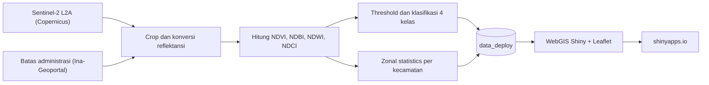

| Tahap | Berkas | Keterangan |
|:--:|---|---|
| 1 | [`analisis/01_ANALISIS_RASTER.R`](analisis/01_ANALISIS_RASTER.R) | Crop citra, hitung indeks, klasifikasi, zonal statistics, ekspor hasil |
| 2 | [`scripts/siapkan_data_deploy.R`](scripts/siapkan_data_deploy.R) | Menyalin hasil analisis ke `data_deploy/` dan `output/` |
| 3 | [`app.R`](app.R) | Aplikasi WebGIS (Shiny + Leaflet) |
| 4 | [`scripts/deploy_shinyapps.R`](scripts/deploy_shinyapps.R) | Mengunggah aplikasi ke shinyapps.io |

Penjelasan detail tiap langkah ada di [`docs/LANGKAH_PENGERJAAN.md`](docs/LANGKAH_PENGERJAAN.md).

---

## Results

### Peta Tutupan Lahan (Land Cover)
<p align="center">
  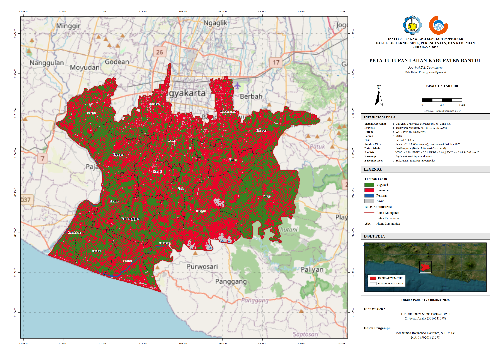
</p>

### Hasil Analisis Indeks Spektral
| NDVI (Vegetation) | NDWI (Water) |
| :---: | :---: |
| 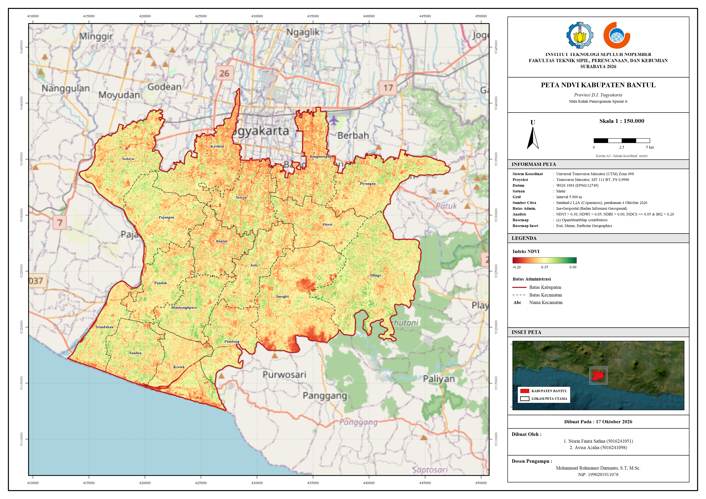 | 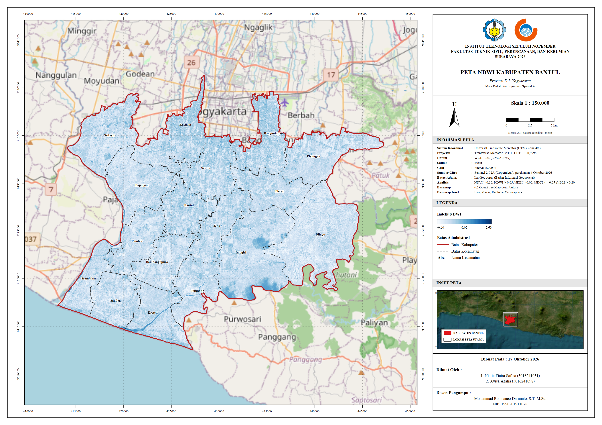 |
| **NDBI (Built-up)** | **NDCI (Cloud)** |
| 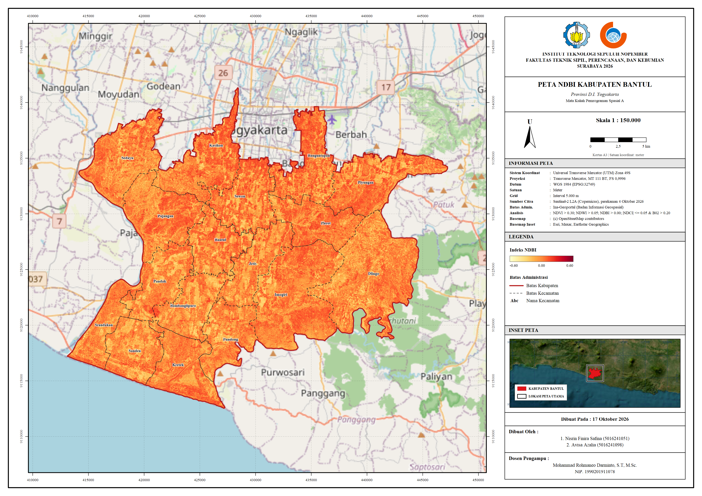 | 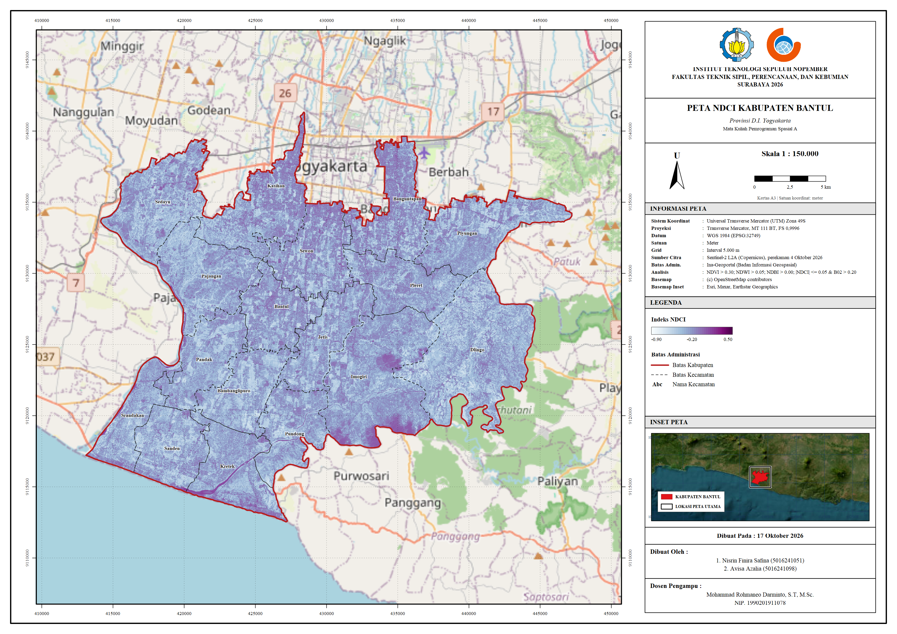 |

---

## Fitur WebGIS

Aplikasi memiliki enam tab: **Peta Interaktif**, **Zonal Statistics**, **Threshold dan Metode**, **Cetak Peta**, **Unduh Data**, dan **Tentang**.

### Gambaran Umum Peta Interaktif

<p align="center">
  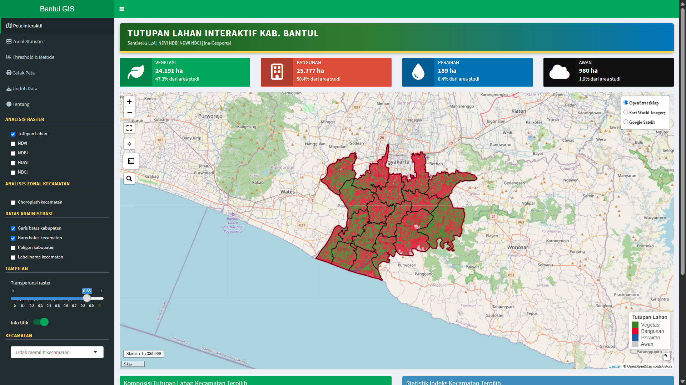
</p>

| No | Komponen | Fungsi |
|:--:|---|---|
| 1 | Panel layer | Menyalakan atau mematikan layer Tutupan Lahan, NDVI, NDBI, NDWI, NDCI, choropleth, dan batas administrasi |
| 2 | Pilihan basemap | Mengganti peta dasar |
| 3 | Slider transparansi | Mengatur transparansi layer analisis |
| 4 | Dropdown kecamatan | Zoom langsung ke kecamatan tertentu |
| 5 | Alat peta | Ukur jarak dan luas, layar penuh, pencarian lokasi |
| 6 | Panel informasi | Ringkasan luas kelas, diagram donat, dan tabel statistik kecamatan terpilih |

### 1. Pilihan Basemap

Tiga peta dasar tersedia: OpenStreetMap, Esri World Imagery, dan Google Satelit. Citra satelit berguna untuk mencocokkan hasil klasifikasi dengan kondisi nyata.

<p align="center">
  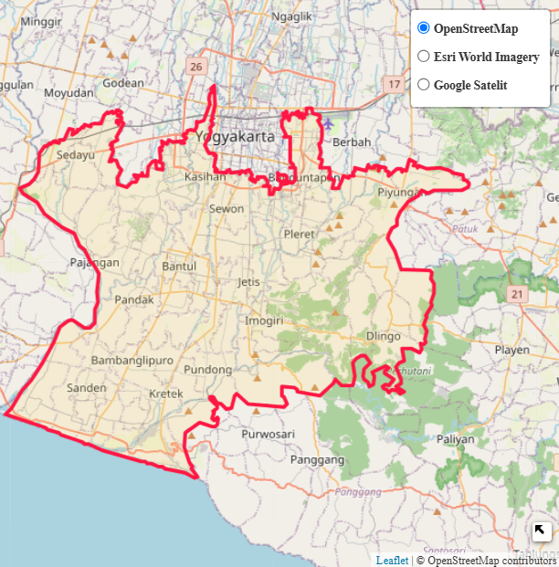
  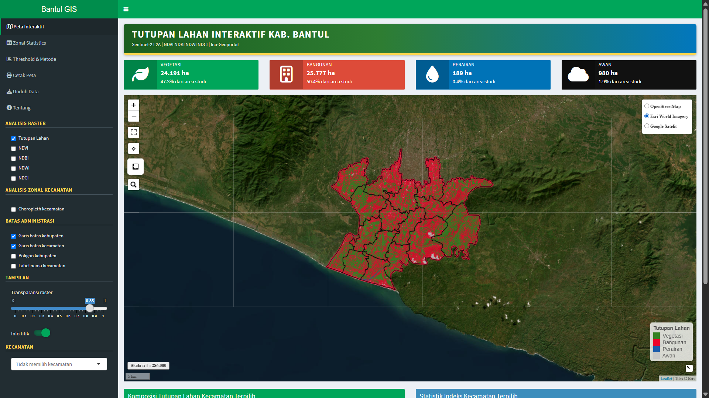
  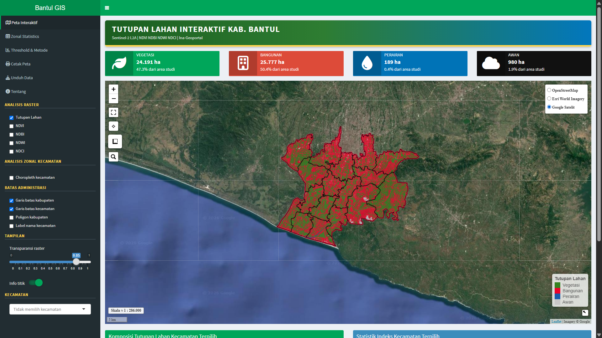
</p>

### 2. Klik Kecamatan

Klik sebuah kecamatan untuk menyorot ke wilayahnya dan menampilkan grafik detailnya. Klik lagi untuk kembali ke tampilan awal.

<p align="center">
  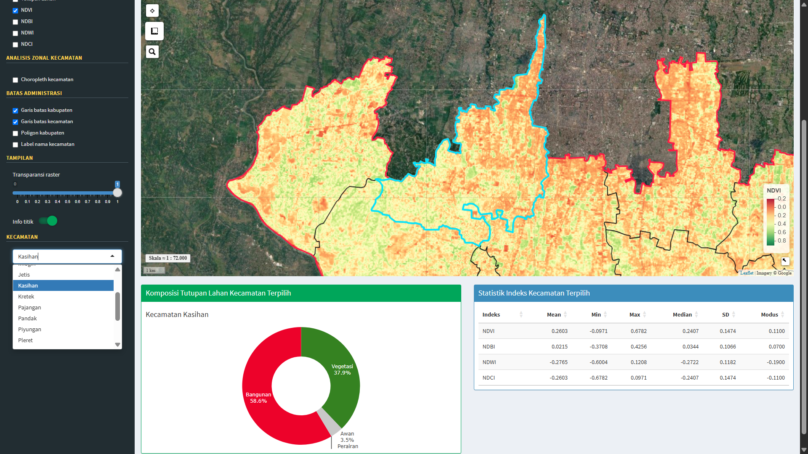
</p>

### 3. Klik Titik (Popup Nilai Indeks)

Klik titik mana pun di peta untuk melihat nilai NDVI, NDBI, NDWI, NDCI, kelas tutupan lahan, serta statistik zonal kecamatan tempat titik itu berada.

<p align="center">
  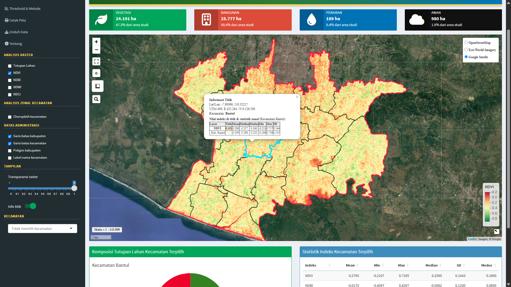
</p>

### 4. Alat Ukur

Ukur jarak dan luas langsung di peta.

<p align="center">
  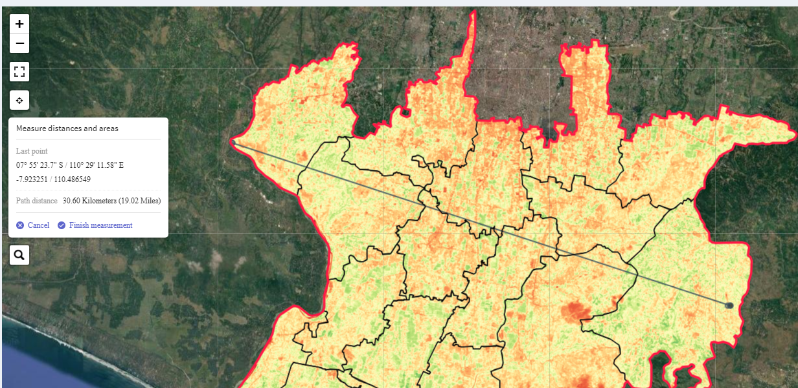
</p>

### 5. Zoom ke Kecamatan

Pilih kecamatan dari dropdown, peta otomatis zoom ke wilayah tersebut.

<p align="center">
  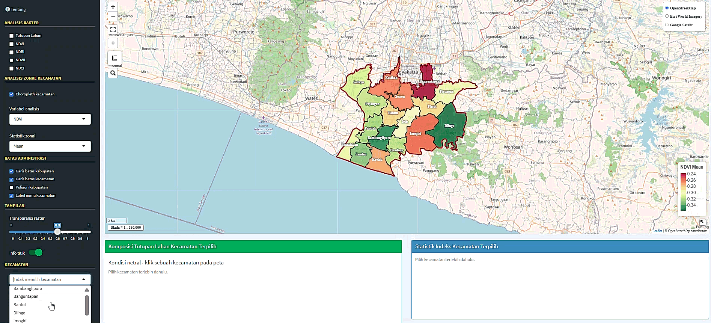
</p>

### 6. Tab Zonal Statistics

Tabel Mean, Min, Max, Median, dan SD untuk NDVI, NDBI, NDWI, NDCI di setiap kecamatan, ditambah tabel luas tutupan lahan (hektar). Tabel bisa disalin atau diekspor ke CSV dan Excel.

<p align="center">
  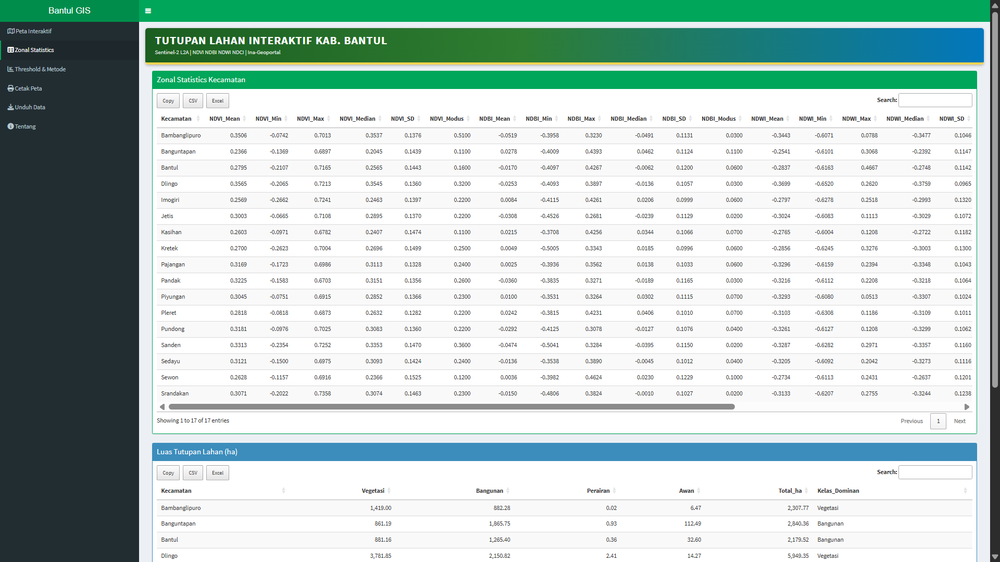
</p>

### 7. Tab Threshold dan Metode

Aturan klasifikasi beserta prioritasnya dan histogram sebaran tiap indeks, lengkap dengan garis threshold.

<p align="center">
  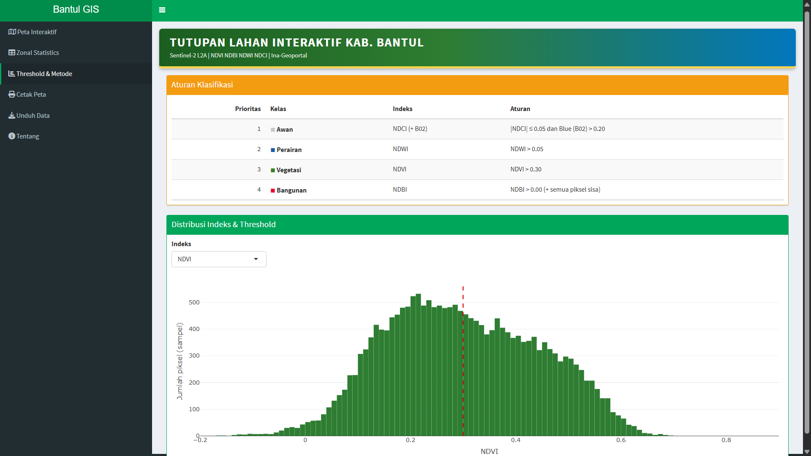
</p>

### 8. Tab Cetak Peta

Menghasilkan peta cetak A3 atau A4 (PNG, PDF, JPEG) dengan judul, legenda, skala, panah utara, grid koordinat UTM, inset lokasi, dan sumber data.

<p align="center">
  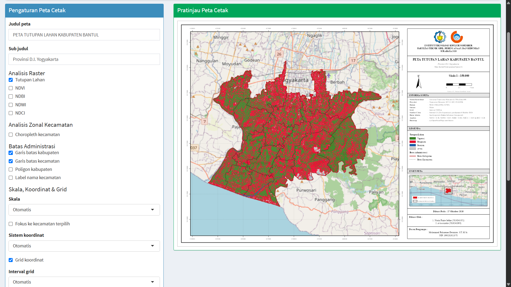
</p>

### 9. Hover Pop Up

Saat menggeser kursor, pop up tabel kecamatan akan muncul tanpa di klik.

<p align="center">
  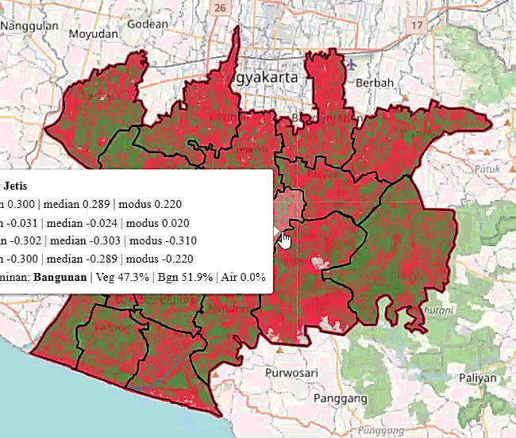
</p>

---

## Indeks Spektral

| Indeks | Nama Lengkap | Rumus | Kegunaan |
|---|---|---|---|
| **NDVI** | Normalized Difference Vegetation Index | `(B08 − B04) / (B08 + B04)` | Vegetasi |
| **NDBI** | Normalized Difference Built-up Index | `(B11 − B08) / (B11 + B08)` | Area terbangun |
| **NDWI** | Normalized Difference Water Index | `(B03 − B08) / (B03 + B08)` | Perairan |
| **NDCI** | Normalized Difference Cloud Index | `(B04 − B08) / (B04 + B08)` | Awan (nilai mendekati 0) |

Keterangan band Sentinel-2: **B02** = Biru, **B03** = Hijau, **B04** = Merah, **B05** = Red Edge 1, **B08** = NIR, **B11** = SWIR 1.

Pra-pemrosesan: B05 dan B11 (20 m) di-*resample* ke 10 m mengikuti B08. Nilai DN dikonversi ke reflektansi memakai `BOA_ADD_OFFSET` dari metadata produk, dibagi 10.000, lalu dipotong dan di-*mask* dengan batas Kabupaten Bantul.

---

## Aturan Klasifikasi Tutupan Lahan

Klasifikasi dilakukan berurutan berdasarkan prioritas. Piksel yang sudah masuk satu kelas tidak dicek lagi untuk kelas berikutnya.

| Prioritas | Kode | Kelas | Aturan | Warna |
|:--:|:--:|---|---|:--:|
| 1 | 4 | **Awan** | \|NDCI\| ≤ 0,05 **dan** B02 > 0,20 |  |
| 2 | 3 | **Perairan** | NDWI > 0,05 |  |
| 3 | 1 | **Vegetasi** | NDVI > 0,30 |  |
| 4 | 2 | **Bangunan** | NDBI > 0,00 dan semua piksel sisa |  |

Nilai threshold tersimpan di [`output/threshold_klasifikasi.csv`](output/threshold_klasifikasi.csv).

---

## Wilayah Studi

**Kabupaten Bantul, D.I. Yogyakarta** (17 kecamatan). Alasan pemilihan:

- **Gradien lanskap yang jelas.** Dari utara yang berbatasan dengan Kota Yogyakarta dan padat permukiman, ke dataran aluvial persawahan di tengah, hingga perbukitan di timur dan garis pantai Samudra Hindia di selatan.
- **Keempat kelas tutupan lahan hadir.** Vegetasi (sawah, kebun, perbukitan), bangunan (permukiman dan pusat kecamatan), perairan (Sungai Progo, Sungai Opak, dan laut selatan), serta awan yang umum muncul pada citra wilayah tropis.
- **Jumlah kecamatan memadai** untuk membandingkan statistik zonal antarwilayah.
- **Data pendukung tersedia**, yaitu batas administrasi skala 1:25.000 (RBI) dari Ina-Geoportal.

---

## Sumber Data

| Data | Sumber | Keterangan |
|---|---|---|
| Citra satelit | [Copernicus Data Space Ecosystem](https://dataspace.copernicus.eu/) | Sentinel-2B MSI Level-2A, tile `T49MDM`, orbit relatif `R089`, perekaman **4 Oktober 2026** |
| Batas administrasi | [Ina-Geoportal (BIG)](https://tanahair.indonesia.go.id/portal-web) | RBI 25K Kabupaten Bantul (layer `ADMINISTRASI_AR_KABKOTA` dan `ADMINISTRASI_AR_KECAMATAN`) |

> Data mentah (citra `.SAFE` dan geodatabase `.gdb`) ini ukurannya besar sehingga **tidak disertakan** di repositori ini :)) tetapi hasil olahan yang sudah siap pakai ada di folder [`data_deploy/`](data_deploy/).

---

## Struktur Repositori

```text
.
├── app.R                                        # Aplikasi WebGIS (Shiny + Leaflet)
├── dependencies.R                               # Daftar package untuk shinyapps.io
├── analisis/
│   └── 01_ANALISIS_RASTER.R                     # Crop, indeks, klasifikasi, zonal statistics
├── data_deploy/                                 # Data siap pakai untuk aplikasi
│   ├── klasifikasi_tutupan_lahan_bantul.tif
│   ├── NDVI.tif
│   ├── NDBI.tif
│   ├── NDWI.tif
│   ├── NDCI.tif
│   ├── hasil_analisis.gpkg                      # Batas kabupaten dan kecamatan + atribut statistik
│   ├── hasil_analisis.rds                       # Metadata, threshold, tabel statistik
│   └── logo_*.png                               # Logo ITS dan Teknik Geomatika untuk peta cetak
├── output/                                      # Tabel hasil (CSV) untuk laporan
│   ├── zonal_statistics_kecamatan.csv
│   ├── statistik_kabupaten.csv
│   ├── luas_tutupan_lahan_kecamatan.csv
│   └── threshold_klasifikasi.csv
├── scripts/
│   ├── siapkan_data_deploy.R                    # Menyalin hasil analisis ke data_deploy/ dan output/
│   └── deploy_shinyapps.R                       # Deploy ke shinyapps.io
├── docs/
│   ├── LANGKAH_PENGERJAAN.md                    # Tutorial berurutan dari data mentah sampai web
│   └── screenshots/                             # Tangkapan layar untuk README
├── CHANGELOG.md                                 # Riwayat perubahan
├── CITATION.cff                                 # Metadata sitasi
├── LICENSE                                      # Lisensi MIT
└── .gitignore
```

---

## Cara Menjalankan

### Opsi A: Buka langsung di browser

**https://nisrinsafina.shinyapps.io/bantul-webgis/**

### Opsi B: Jalankan di komputer sendiri (tanpa data mentah)

Cara ini paling mudah karena semua data olahan sudah ada di `data_deploy/`.

1. Install [R](https://cran.r-project.org/) dan [RStudio](https://posit.co/download/rstudio-desktop/).
2. Install package:

   ```r
   install.packages(c(
     "shiny", "shinydashboard", "shinyWidgets", "leaflet", "leaflet.extras",
     "sf", "terra", "DT", "plotly", "png", "jpeg", "maptiles", "htmlwidgets",
     "rstudioapi"
   ))
   ```

3. Unduh repositori ini (tombol hijau **Code → Download ZIP**, lalu ekstrak) atau lewat Git:

   ```bash
   git clone https://github.com/nisrinsafina/bantul-webgis.git
   ```

4. Buka folder hasil unduhan di RStudio, buka `app.R`, lalu klik **Run App**. Atau dari Console:

   ```r
   setwd("path/ke/bantul-webgis")
   shiny::runApp()
   ```

### Opsi C: Ulangi seluruh analisis dari data mentah

1. Unduh citra Sentinel-2 L2A dan batas administrasi, lalu susun foldernya seperti ini:

   ```text
   Folder/
   ├── 01_Satellite_Data/20261004/S2B_MSIL2A_..._T49MDM_....SAFE
   └── 02_Administration_Data/Kab Bantul RBI BIG/....gdb
   ```

2. Buka `analisis/01_ANALISIS_RASTER.R`, ubah baris `setwd(...)` ke lokasi `Folder` di komputermu, lalu jalankan seluruh script. Hasilnya muncul di `03_Cropped/`, `04_Index/`, `05_Classification/`, dan `06_WebGIS/`.
3. Jalankan `scripts/siapkan_data_deploy.R` (ubah dua path di bagian atas) untuk menyalin hasil ke `data_deploy/` dan `output/`.
4. Jalankan `app.R`.

### Deploy ke shinyapps.io

Isi `account`, `token`, dan `secret` pada [`scripts/deploy_shinyapps.R`](scripts/deploy_shinyapps.R) dari halaman **Account → Tokens** di shinyapps.io, lalu jalankan script tersebut. Langkah lengkap ada di [`docs/LANGKAH_PENGERJAAN.md`](docs/LANGKAH_PENGERJAAN.md#11-deploy-ke-shinyappsio).

---

## Keluaran

Semua tabel hasil ada di folder [`output/`](output/).

**`zonal_statistics_kecamatan.csv`** berisi satu baris per kecamatan (17 baris). Kolomnya `Kecamatan` dan `<INDEKS>_<STATISTIK>` untuk NDVI, NDBI, NDWI, dan NDCI:

| Kolom | Keterangan |
|---|---|
| `*_Mean` | Rata-rata |
| `*_Min` | Minimum |
| `*_Max` | Maksimum |
| `*_Median` | Median |
| `*_SD` | Standar deviasi |
| `*_Modus` | Modus (tambahan, dibulatkan 2 desimal) |

Contoh nama kolom: `NDVI_Mean`, `NDBI_Median`, `NDWI_SD`, `NDCI_Max`.

| Berkas | Isi |
|---|---|
| `statistik_kabupaten.csv` | Statistik indeks untuk seluruh Kabupaten Bantul |
| `luas_tutupan_lahan_kecamatan.csv` | Luas (ha) tiap kelas per kecamatan, total luas, dan kelas dominan |
| `threshold_klasifikasi.csv` | Parameter threshold dan metode yang dipakai |

---

## Teknologi

| Kategori | Alat |
|---|---|
| Bahasa dan lingkungan | R, RStudio |
| Aplikasi web | `shiny`, `shinydashboard`, `shinyWidgets` |
| Peta interaktif | `leaflet`, `leaflet.extras` |
| Data raster | `terra` |
| Data vektor | `sf` |
| Tabel dan grafik | `DT`, `plotly` |
| Peta cetak | `maptiles`, `png`, `jpeg`, grafik dasar R |
| Manipulasi data | `dplyr` |
| Hosting | shinyapps.io |

---

## Catatan dan Keterbatasan

- **Threshold bersifat empiris** (NDVI > 0,30; NDWI > 0,05; NDBI > 0,00; |NDCI| ≤ 0,05 dan B02 > 0,20) dan belum divalidasi dengan data lapangan, sehingga akurasi klasifikasi belum dihitung.
- **Kelas "bangunan" adalah kelas sisa.** Piksel yang tidak masuk awan, perairan, atau vegetasi dimasukkan ke bangunan, jadi lahan terbuka atau tanah kosong bisa ikut terhitung sebagai bangunan.
- **NDCI hanya pendekatan awan.** Bayangan awan dan permukaan sangat terang (misalnya pasir pantai atau atap putih) berpotensi tercampur.
- **Hanya satu tanggal perekaman** (4 Oktober 2026), sehingga hasil tidak mewakili kondisi musiman.
- Tugas menyebut paket `rgdal` dan `raster`. Keduanya sudah tidak dipelihara di CRAN, sehingga proyek ini memakai **`sf` dan `terra`** sebagai penggantinya.
- Paket gratis shinyapps.io memiliki batas memori dan jam aktif. Aplikasi bisa terasa lambat saat pertama dibuka.

---

## Penulis

| Nama | NRP |
|---|---|
| Nisrin Finira Safina | 5016241051 |
| Avisa Azalia | 5016241098 |

**Dosen Pengampu:**
Mohammad Rohmaneo Darminto, S.T., M.Sc.
Departemen Teknik Geomatika
Fakultas Teknik Sipil, Perencanaan, dan Kebumian
Institut Teknologi Sepuluh Nopember
Surabaya
2026

## Lisensi

Kode dirilis di bawah [Lisensi MIT](LICENSE). Data Sentinel-2 mengikuti ketentuan Copernicus, dan batas administrasi mengikuti ketentuan Badan Informasi Geospasial (Ina-Geoportal).

Jika memakai proyek ini, silakan sitasi melalui [`CITATION.cff`](CITATION.cff). GitHub menampilkan tombol **Cite this repository** di sisi kanan halaman utama.
